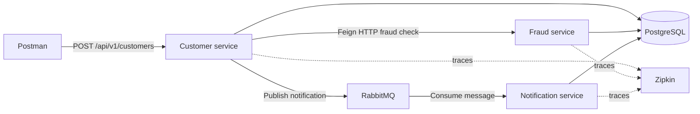

# Microservices — a hands-on learning journey

This repository is my practical learning journey alongside a microservices course. I use it to learn a concept, apply it in a real project, and try it locally—not as a production-ready platform.

The project has grown from independent Spring Boot services into a system that can run in local Kubernetes. The current learning focus is the request flow between services, asynchronous messaging, local containers, Kubernetes, and distributed tracing.

> **No cloud bill required:** the Kubernetes workflow in this repository uses Minikube and Docker on your own machine. It does not require Linode or a paid image registry. Minikube and k3d are both ways to run Kubernetes locally; this project uses the existing Minikube cluster.

## What the system does



Customer registration saves the customer, asks Fraud to check the customer, and—if the customer passes—publishes a notification message to RabbitMQ. Notification consumes that message and records the notification.

The current Kubernetes request trace contains six spans:

1. Customer HTTP request
2. `customer.registration` business operation
3. Customer's Feign client request
4. Fraud HTTP request
5. RabbitMQ message publish
6. Notification message consume

## Services and modules

| Module | Responsibility | Local application port |
| --- | --- | ---: |
| `customer` | Customer API, persistence, fraud check, and notification publish | 8080 |
| `fraud` | Fraud-check API and history | 8082 |
| `notification` | Notification API and RabbitMQ consumer | 8081 |
| `clients` | Shared Feign clients and request/response types | — |
| `amqp` | Shared RabbitMQ producer and message configuration | — |
| `apigw` | Spring Cloud API gateway module | 8083 |
| `eureka-server` | Service discovery module | 8761 |

The current Minikube manifests deploy Customer, Fraud, Notification, PostgreSQL, RabbitMQ, and Zipkin. The API gateway and Eureka modules are part of the project, but are not included in this local Kubernetes deployment.

## Technology

- Java 21
- Spring Boot 4.1.2 and Spring Cloud
- Spring Web, Spring Data JPA, and PostgreSQL
- Spring Cloud OpenFeign for the synchronous customer-to-fraud call
- RabbitMQ for asynchronous notifications
- Micrometer Tracing and Zipkin
- Docker and Jib for container images
- Kubernetes with Minikube

## Run on Minikube (Windows PowerShell)

### Prerequisites

- Docker Desktop running with its Linux container engine
- Minikube and `kubectl`
- JDK 21
- Maven 3.9 or later
- PowerShell

The local Kubernetes image workflow uses Minikube's registry addon. Its first run needs internet access to obtain the registry and image-transfer helper images, but your application images are kept in the local Minikube registry; you do not push them to Docker Hub or a cloud provider.

### First-time cluster setup

Start Minikube and select its Kubernetes context:

```powershell
minikube start
kubectl config use-context minikube
minikube addons enable registry
```

Create the PostgreSQL resources, RabbitMQ, and Zipkin:

```powershell
kubectl apply -f .\k8s\minikube\bootstrap\postgres\configmap.yml
kubectl apply -f .\k8s\minikube\bootstrap\postgres\volume.yml
kubectl apply -f .\k8s\minikube\bootstrap\postgres\service.yml
kubectl apply -f .\k8s\minikube\bootstrap\postgres\statefulset.yml
kubectl apply -f .\k8s\minikube\bootstrap\rabbitmq\rabbitmq.yml
kubectl apply -f .\k8s\minikube\bootstrap\zipkin\service.yml
kubectl apply -f .\k8s\minikube\bootstrap\zipkin\statefulset.yml
```

Wait for the dependencies to start:

```powershell
kubectl wait --for=condition=Ready pod/postgres-0 --timeout=180s
kubectl rollout status deployment/rabbitmq --timeout=180s
kubectl rollout status statefulset/zipkin --timeout=180s
```

The PostgreSQL ConfigMap initializes the `mobin` database. On a brand-new cluster, create the three application databases once:

```powershell
kubectl exec postgres-0 -- psql -U mobin -d postgres -c "CREATE DATABASE customer;"
kubectl exec postgres-0 -- psql -U mobin -d postgres -c "CREATE DATABASE fraud;"
kubectl exec postgres-0 -- psql -U mobin -d postgres -c "CREATE DATABASE notification;"
```

If a database already exists, PostgreSQL reports that; do not delete the database. The example database and RabbitMQ credentials in these local manifests are for learning only and are not suitable for production.

### Build, load, and deploy the application services

From the repository root, run:

```powershell
.\k8s\minikube\deploy-local.ps1
```

The script checks that the active Kubernetes context is Minikube, builds the Customer, Fraud, and Notification images, transfers them into Minikube's local registry, applies their manifests, and waits for each rollout. The Kubernetes deployments use `imagePullPolicy: Always` and images under `localhost:5000/mobin/`; this registry address is Minikube's in-cluster registry proxy, not a public registry.

Check that the application is ready:

```powershell
kubectl get pods
kubectl get deployments customer fraud notification
```

Customer, Fraud, and Notification should each show one ready replica.

## Test customer registration with Postman

Forward the Customer service to your computer. Keep this command running in its own PowerShell window:

```powershell
kubectl port-forward svc/customer 18080:80
```

In Postman, create this request:

- **Method:** `POST`
- **URL:** `http://localhost:18080/api/v1/customers`
- **Header:** `Content-Type: application/json`
- **Body:** **raw** → **JSON**

```json
{
  "firstName": "Trace",
  "lastName": "Test",
  "email": "trace-test@example.com"
}
```

A successful registration returns HTTP `200` with an empty response body. The customer is saved, checked by Fraud, and a notification is sent through RabbitMQ.

## View traces in Zipkin

In another PowerShell window, keep the Zipkin port-forward running:

```powershell
kubectl port-forward svc/zipkin 19411:9411
```

Open [http://localhost:19411](http://localhost:19411), find the latest `customer` trace, and inspect its six spans. Zipkin only shows traces after requests have been made while all services are running.

Useful service logs:

```powershell
kubectl logs -f deployment/customer
kubectl logs -f deployment/fraud
kubectl logs -f deployment/notification
```

Each command follows one service's logs; run them in separate terminals if you want to watch all three at once.

## Rebuild after changing code

After changing Customer, Fraud, or Notification, rerun:

```powershell
.\k8s\minikube\deploy-local.ps1
```

It rebuilds and redeploys all three application services. The PostgreSQL, RabbitMQ, and Zipkin dependencies remain in the cluster.

## Docker Compose alternative

Docker Compose is also available for running the project without Kubernetes:

```powershell
mvn -DskipTests clean package -P build-docker-image
docker compose up -d postgres rabbitmq zipkin
docker compose exec -T postgres psql -U mobin -d postgres -c "CREATE DATABASE customer;"
docker compose exec -T postgres psql -U mobin -d postgres -c "CREATE DATABASE fraud;"
docker compose exec -T postgres psql -U mobin -d postgres -c "CREATE DATABASE notification;"
docker compose up -d
docker compose ps
```

The database creation commands are for a fresh Compose volume and should be run once. If a database already exists, PostgreSQL reports that; keep the existing database.

The Compose file currently starts Customer, Fraud, Notification, PostgreSQL, RabbitMQ, and Zipkin. The API gateway and Eureka service definitions are commented out. Notification is published on host port `8084` to avoid a conflict with another local service; it still listens on port `8081` inside Compose.

## Stop Minikube

Stop the local cluster while keeping its configuration and data:

```powershell
minikube stop
```

Start it again later with `minikube start`. `minikube delete` removes the cluster and its local Kubernetes resources; use it only if you intend to reset the learning environment.

## Learning and safety notes

- `create-drop` is enabled in the service database profiles for testing. Restarting a service drops and recreates its table, so its test data is lost. This is intentional for the current learning setup.
- The database and RabbitMQ credentials in the local examples are demonstration values. Do not reuse them in production or expose real credentials in Git.
- Minikube runs on your computer, so cluster capacity and availability depend on that computer and Docker Desktop.
- This repository is a learning project and has not been hardened for production deployment.
